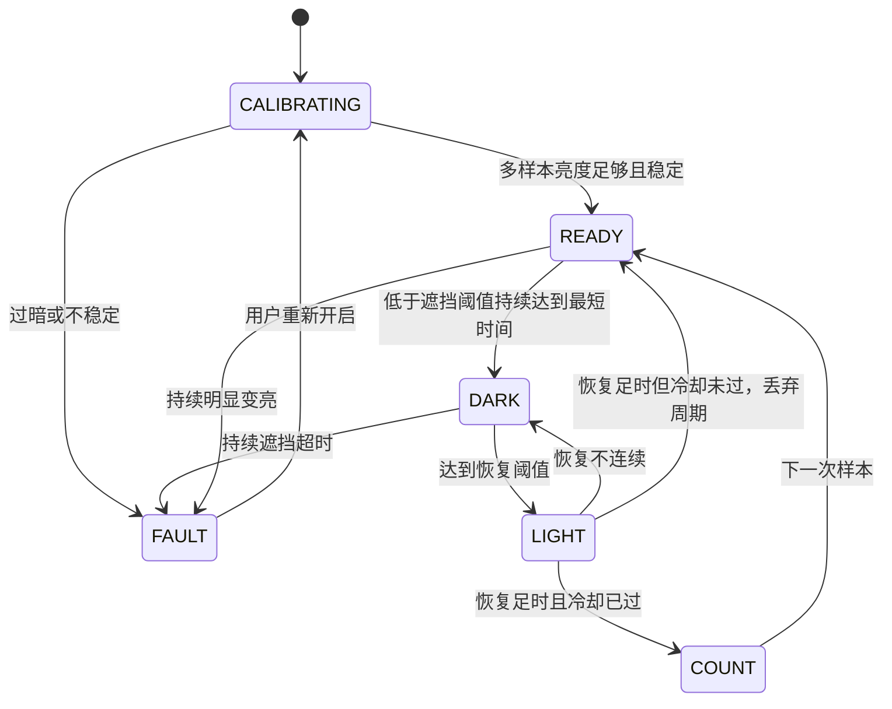

# 阶段 0：光学计数可行性报告

核查日期：2026-11-09（Asia/Hong_Kong）。结论级别：**公开接口已核对；算法模拟通过；真机硬件及实际动作效果待验证**。

## 1. 环境光传感器可用性

在微信官方 API 文档导航和最新公开类型包中，**未发现直接读取环境光传感器的公开微信小程序 API**。对 `miniprogram-api-typings@5.3.1` 的 `types/wx/lib.wx.api.d.ts` 检索 `AmbientLight`、`LightSensor`、`startLight`、`onLight`、`环境光`、`光照`，均无匹配。官方类型仓库说明 API 类型随官方文档自动生成，可作交叉证据，但类型覆盖不是设备实测保证。[官方类型仓库](https://github.com/wechat-miniprogram/api-typings)、[npm 最新发布元数据](https://registry.npmjs.org/miniprogram-api-typings/latest)。

因此不能在本项目中直接实现内置环境光照度读取；不存在可据以承诺的 Android/iOS 基础库版本。手机有物理传感器，不代表微信 JS 沙箱向小程序暴露它。原生 Android 调用、浏览器传感器对象、其他平台同名 API 或 UniApp 原生插件均不符合本项目约束；不采用、不构造 `wx.startLightSensor` 一类调用。此结论限定为本次公开资料范围，未来新增公开接口需重新核查。

核查时 GitHub master 的 package.json 为 5.2.3，而 npm `latest` 为 **5.3.1**；已额外下载 npm 最新 tarball，只读取声明文件交叉核查，未安装/执行包代码，也不把 master 当作最新发布。版本与完整性标识见 [api-audit.json](api-audit.json)，可重跑 `scripts/audit-wechat-apis.ps1`。

## 2. 官方公开 API 核对

| 能力 | 结果 / 约束 | 依据 |
| --- | --- | --- |
| `camera` | 组件最低基础库 1.6.0；支持 `device-position="front"`；需 `scope.camera` 授权；同页最多一个 | [camera 官方文档](https://developers.weixin.qq.com/miniprogram/dev/component/camera.html) |
| `frame-size` | 最低 2.7.0；small/medium/large 为期望尺寸，实际宽高由系统决定，不能按组件显示尺寸解析像素 | 同上 |
| `bindinitdone` | 最低 2.7.0；初始化完成后再创建帧监听；本 Demo 不读取较晚版本才返回的 maxZoom | 同上 |
| `CameraContext.onCameraFrame` | 最低 **2.7.0**；返回监听器；回调带 width、height、ArrayBuffer RGBA；必须设置 frame-size | [onCameraFrame 官方文档](https://developers.weixin.qq.com/miniprogram/dev/api/media/camera/CameraContext.onCameraFrame.html) |
| `CameraFrameListener.start/stop` | 真实存在；使用成功/失败回调，不能假设 Promise；停止监听后仍要卸载 camera 组件释放相机预览 | [start](https://developers.weixin.qq.com/miniprogram/dev/api/media/camera/CameraFrameListener.start.html)、[stop](https://developers.weixin.qq.com/miniprogram/dev/api/media/camera/CameraFrameListener.stop.html) |
| 插件运行环境 | `onCameraFrame` 官方标注不支持小程序插件；本项目是独立原生小程序 | onCameraFrame 官方文档 |
| `wx.canIUse` | 可检测 `CameraContext.onCameraFrame` 和 `CameraFrameListener.start` 等公开能力；再检查实际对象方法，最终必须看到真实回调 | [canIUse 官方文档](https://developers.weixin.qq.com/miniprogram/dev/api/base/wx.canIUse.html)及官方类型示例 |
| 隐私授权 | `wx.requirePrivacyAuthorize` 最低 2.32.3；可配合应用级 onNeedPrivacyAuthorization 和真实同意按钮处理，再申请 scope.camera | [requirePrivacyAuthorize 官方文档](https://developers.weixin.qq.com/miniprogram/dev/api/open-api/privacy/wx.requirePrivacyAuthorize.html) |

**版本要分开看**：帧接口最低 2.7.0；本实验为完整实现上述隐私流程，摄像头路径主动要求 **≥ 2.32.3**。项目不固定某个最新调试库版本，导入后选工具提供的稳定版本并记录版本号。低版本只启用触屏/模拟。不存在“达到版本号就保证所有手机可用”的推论。

本次直接通过 HTTPS 获取并阅读微信官方 HTML，辅以官方类型包；网页检索工具一度无法直接打开微信文档，没有用第三方平台同名 API 代替证据。核查副本位于系统临时目录，项目只保存链接和核查元数据。

## 3. 实现路径对比

| 路径 | 可行性 | 优点 | 代价 / 局限 | 决策 |
| --- | --- | --- | --- | --- |
| 内置环境光传感器 | 未找到公开读取接口 | 若有通常耗电较低 | 无可用公开调用，无可保证的双平台支持 | 不实现 |
| 前置 camera + 帧亮度 | 公开采集路径可用；效果待实测 | 本地、无需姿态模型、可观测数值 | 授权、隐私配置、自动曝光、画面内容、性能/耗电、摆位 | 阶段 0 实验 |
| 触屏事件 | 原生公开交互路径 | 无摄像头、离线、实现简单 | 需触碰；最小间隔只能抑制误触，无法识别动作 | 默认降级；实验中提供对照 |
| 手动增减 | 普通界面操作 | 纠错与备用 | 依赖用户 | 所有运行模式可显式调整 |
| AI 姿态识别 / 外部硬件 | 超出阶段与需求 | 不评估 | 增加模型、设备或系统复杂性 | 不采用 |

前置摄像头拍到的是场景亮度，不是环境光传感器的照度。脸接近镜头可能变暗，也可能在自动曝光补偿下不变或变亮；算法无法保证“面部靠近必然变暗”，也不能从一次明暗变化证明完成俯卧撑。若镜头被盖住能计数而实际动作不能，就只证明数据通路可用，不能宣布产品光学模式可用。

## 4. 最小实验设计与文件职责

实验工程放在 `experiments/optical-demo/`，独立于正式产品；阶段 1 后使用实验目录自己的 `project.config.json` 单独导入，仓库根配置指向正式 `miniprogram/`。完整文件清单见 [README](../README.md)。核心流程：

```text
主动开启 → 检测平台/基础库/API → 隐私同意 → scope.camera 授权
→ 挂载前置 camera(frame-size=small) → initdone → listener.start
→ RGBA中心区域抽样 → 亮度标量 → 预热/校准 → 平滑/迟滞状态机
→ 完整周期事件 → 统一计数器 → 数字/震动
```

- `luminance.js`：校验实际 width/height/字节数；只在回调内读取中心约 70% 区域、最多约 32×32 个采样像素，用整数权重近似亮度。输出标量 0–255，不是 lux；不持有帧、不存图片、不创建图像缓存。
- `optical-fsm.js`：不引用 wx，接受模拟亮度和时间戳；使用多样本均值、变异系数、指数平滑、明暗相对阈值、迟滞和持续时间。
- `counter.js`：最小统一计数器，只接受当前 camera/simulation/touch 自动源，manual 为显式调整；触屏 touchstart 计一次、touchend/touchcancel 解锁、最小间隔防抖。
- 页面：真实前置预览、实时原始/平滑/基准/比值、校准进度、状态、抽样尺寸与处理耗时、参数滑块、诊断复制及手动调整。
- `signals.js`：正常三周期、抖动、持续遮挡、低亮度、不稳定校准；明确显示“模拟信号 · 非真机”。
- 生命周期：授权/帧回调携带会话标记；切换、暂停、后台、卸载均使旧回调失效。停止帧监听、清定时器并条件卸载 camera。返回原摄像头会话重走开启流程且重新校准，不承接半周期。触屏/模拟进入后台后保持停止，需主动重启。
- 故障：能力不足、拒绝授权、初始化超时、帧格式错误、无帧、过暗、不稳定、持续遮挡、明显变亮均停止光学并切触屏。部分短断帧由算法重新校准。

这里的实验计数器仅用于对照与降级，后续阶段再集成正式训练流程。平板支撑计时、五组训练、存储等均未开发。

## 5. 状态机与参数



任何非故障状态出现超过最大样本间隔的断流都会重新校准，不把断流时间当稳定持续时长。READY 中有遮挡候选计时，短暂变暗不会直接进入 DARK；LIGHT 恢复被打断时重新计算恢复持续时间。一次计数来自完整暗→亮周期，不在 DARK 中反复加一。

| 实验默认参数 | 值 | 含义 |
| --- | --- | --- |
| 处理间隔 / 界面节流 | 100 ms / 约 200 ms | 尽量降低 JS 和 setData 负载；状态变化与有效计数立即更新 |
| 相机预热 | 1000 ms | 尝试避开启动曝光变化，不保证足以稳定所有机型 |
| 校准 | ≥20 样本，跨度≥1800 ms | 总过程通常约 3 秒，基准固定到下次校准 |
| 过暗 / 不稳定 | 基准<18；CV>0.12 | CV 为标准差/均值，阈值仅为实验值 |
| 平滑 | alpha=0.35 | EMA 降低单样本波动 |
| 默认遮挡 / 恢复比值 | 约0.625 / 0.805 | 灵敏度滑块改变相对阈值，修改后重新校准 |
| 最短暗 / 亮 | 250 ms / 250 ms | 连续达标才推进状态 |
| 光学冷却 / 统一源间隔 | 900 ms / 默认600 ms | 多道时序约束；统一间隔可调300–1500 ms |
| 持续暗 / 样本断流 | 6000 ms / 600 ms | 前者报故障；后者重新校准 |
| 原始帧静默 / 初始化 | >3000 ms / 12000 ms | 页面降级触屏；授权阅读超过初始化期限也可能超时，可重试 |

数值全部是起点，不是已验证参数。真实帧频/曝光会改变有效时序与漏计率。算法只能限制特定噪声；持续的灯光变化可能与真实动作无法区分。校准后明显变暗与长时间遮挡也无法可靠区分，按超时要求重新校准。

## 6. Android / iOS 风险与判断

| 环节 | Android 风险 | iPhone/iOS 风险 | 验证方式 |
| --- | --- | --- | --- |
| 公开采集路径 | 厂商 ROM、前置镜头、微信版本差异 | 系统隐私控制、微信版本、前置镜头差异 | 分别记录实际 RGBA 回调、尺寸、基础库 |
| 授权 | 小程序权限与系统给微信的权限可能不同 | 同样存在系统与小程序两层相机权限 | 首次允许、拒绝、设置恢复各测一次 |
| 自动曝光 | 可能抵消遮挡、引起亮度漂移 | 同类问题，算法参数不保证能共用 | 空镜→手掌→实际动作三层测试 |
| 机身几何 | 镜头位置/广角影响遮挡比例 | 刘海/灵动岛/镜头位置影响靠近方向 | 手机固定，不同摆位分别记录 |
| 图像与布局 | 实际帧尺寸不等于组件尺寸 | 同样可能裁切/方向不同 | 使用回调尺寸解析；中心亮度对旋转相对不敏感但仍需实测 |
| 性能 | 中低端机帧回调成本、发热耗电 | 长时间相机使用同样有负担 | 至少5分钟，观察卡顿/温升/耗电；JS抽样耗时仅是局部指标 |
| 后台与资源 | 切后台可能触发 stop 或断帧 | 同样需验证系统相机指示与恢复 | 后台/锁屏/返回/关闭/切模式反复测试 |

官方文档给出通用接口与基础库下限，本次未取得足以对所有 Android/iOS 版本作保证的机型支持矩阵。不能把 `canIUse=true`、看到预览或模拟器通过当作收到真实可用帧，更不能据此宣布真实动作计数准确。

## 7. 继续/降级标准

先执行 [真机测试步骤](phase-0-testing.md)并填写[结果表](validation-results.md)：

1. **采集可行**：至少一个目标 Android 和一个 iPhone 真机取得有效帧、能校准、退出不继续采集。
2. **遮挡可行**：稳定光线下，手掌10个完整周期仅新增10次；单纯持续遮挡/快速晃动不重复累计。
3. **实际动作可行**：真实俯卧撑连续3轮各10次，记录误计/漏计、摆位、环境和阈值；可先暂定每轮误差≤1次且静置1分钟0误计为实验门槛，由用户实测后决定是否足够。
4. **降级可行**：权限拒绝、无帧、暗光、后台等失败后触屏仍可用，旧摄像头回调不会叠加计数。

这些门槛是实验验收建议，不是本次已经达成的结论。若只能手掌遮挡通过、实际动作失败，保留诊断接口并默认触屏；若两平台表现不同，应按实测限制光学可用范围。阶段 0 交付时项目停在实验阶段；用户后续已明确授权阶段 1 工程骨架，光学模式仍等待真机结果，不随工程阶段提升而自动标为可用。
